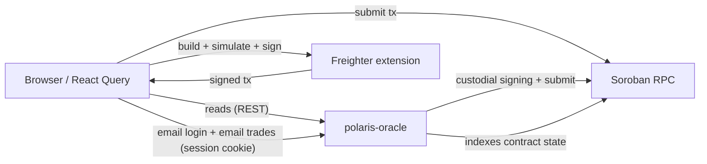

# Frontend architecture & data flow

This page explains where the frontend's data comes from, which data it trusts, and how often each query polls. Read it before you add a new query key or change a polling interval.

## Data flow

- **Reads**: all of them (markets, perpetuals, odds/prices, positions, fees, balances, admin stats) go through polaris-oracle's REST API in `src/lib/api.ts`. The base URL is `config.oracleUrl` in `src/lib/config.ts`.
- **Writes (Freighter)**: the browser builds, simulates, and sends its own transactions straight to Soroban RPC (`config.stellarRpcUrl`). Freighter signs them. See `src/lib/freighter-wallet.ts`. The oracle never sees the user's key.
- **Writes (email wallets)**: this is the fallback for browsers without a wallet extension. The browser calls `/auth/email/*` on the oracle with an httpOnly session cookie, and the oracle signs and submits with a custodial key.

## Trust boundaries

| Boundary                             | Trusted for                                           | Not trusted for                                                                                                   |
| ------------------------------------ | ----------------------------------------------------- | ----------------------------------------------------------------------------------------------------------------- |
| polaris-oracle REST                  | Displaying state (lists, prices, positions, balances) | Anything a Freighter user signs. Trade parameters come from the user and are simulated against RPC before signing |
| Soroban RPC                          | Simulation results and transaction submission         | — (public network parameters only, no secrets)                                                                    |
| Freighter                            | Holding keys and signing                              | — the frontend never sees a secret key                                                                            |
| Email session (oracle)               | Custodial signing for email users                     | Treat it as the oracle acting for the user. Only the oracle holds that key                                        |
| Admin key (`admin-key-provider.tsx`) | Gating `/admin` reads                                 | Client-side gate only. The oracle enforces it                                                                     |

All `NEXT_PUBLIC_*` values are public and get baked into the bundle. Never put a secret in one.

## Query keys & polling

Intervals are tiers. Reuse one of them instead of inventing a new number:

- **8s, `RESOLUTION_POLL_MS`** (`src/lib/format.ts`): a market waiting to resolve. It applies only while `isPollableStatus(status)` is true, so users see the outcome quickly.
- **15s**: prices, fees, and perpetual state while it is `watching`. These move with trading activity.
- **20s**: the connected wallet's XLM balance.
- **30s**: lists and admin dashboards. These change slowly.
- **none**: fetched once and refreshed only by invalidation after a write.

| Query key                            | Interval                        | Owner component(s)                                                                                                                                   | Invalidated by                                              |
| ------------------------------------ | ------------------------------- | ---------------------------------------------------------------------------------------------------------------------------------------------------- | ----------------------------------------------------------- |
| `['markets']`                        | 30s                             | `app/(app)/page.tsx`, `app/(app)/markets/page.tsx`. Also read without polling in `bets/page.tsx`, `use-portfolio-value.ts`, `admin/markets/page.tsx` | Admin market create/update (`admin/markets/page.tsx`)       |
| `['market', id]`                     | 8s while pollable, else none    | `components/trade-card.tsx`, `app/(app)/market/[id]/page.tsx`. Also read without polling in `markets/page.tsx`, `bets/page.tsx`                      | —                                                           |
| `['state', id]`                      | 8s while pollable, else none    | `trade-card.tsx`, `market/[id]/page.tsx`. Also read without polling in `bets/page.tsx` and the rollover read in `trade-card.tsx`                     | —                                                           |
| `['price', id]`                      | 15s                             | `app/(app)/page.tsx`, `markets/page.tsx`, `market/[id]/page.tsx`. Also read without polling in `bets/page.tsx`                                       | Trade success (`trade-card.tsx`)                            |
| `['fee', id]`                        | 15s                             | `trade-card.tsx`, `market/[id]/page.tsx`                                                                                                             | —                                                           |
| `['position', id, address]`          | none                            | `trade-card.tsx`, `bets/page.tsx`                                                                                                                    | Trade, claim, and rollover success (`trade-card.tsx`)       |
| `['perpetuals']`                     | 30s                             | `app/(app)/perpetuals/page.tsx`. Also read without polling in `bets/page.tsx`, `admin/perpetuals/page.tsx`                                           | Admin perpetual create/update (`admin/perpetuals/page.tsx`) |
| `['perpetual', id]`                  | none                            | `perpetual-trade-card.tsx`, `perpetuals/page.tsx`, `perpetual/[id]/page.tsx`, `bets/page.tsx`                                                        | —                                                           |
| `['perpetualState', id]`             | 15s while `watching`, else none | `perpetual-trade-card.tsx`, `perpetual/[id]/page.tsx`. Also read without polling in `bets/page.tsx`                                                  | Admin price checkpoint (`admin/perpetuals/page.tsx`)        |
| `['perpetualPrice', id]`             | 15s                             | `perpetuals/page.tsx`, `perpetual/[id]/page.tsx`. Also read without polling in `bets/page.tsx`                                                       | Trade success (`perpetual-trade-card.tsx`)                  |
| `['perpetualFee', id]`               | 15s                             | `perpetual-trade-card.tsx`, `perpetual/[id]/page.tsx`                                                                                                | —                                                           |
| `['perpetualPosition', id, address]` | none                            | `perpetual-trade-card.tsx`, `bets/page.tsx`                                                                                                          | Trade and claim success (`perpetual-trade-card.tsx`)        |
| `['walletBalance', address]`         | 20s                             | `components/auth-controls.tsx`                                                                                                                       | —                                                           |
| `['admin', 'overview', key]`         | 30s                             | `app/admin/page.tsx`                                                                                                                                 | —                                                           |
| `['admin', 'fee-revenue', key]`      | 30s                             | `app/admin/fee-revenue/page.tsx`                                                                                                                     | —                                                           |
| `['admin', 'network', key]`          | 30s                             | `app/admin/network/page.tsx`                                                                                                                         | —                                                           |

React Query shares a cache entry when two components use the same key. If several components use one key, the shortest active `refetchInterval` wins. Keep keys identical, including element order, so that invalidations reach every reader.

## Adding a query

1. Reuse an existing key shape where one fits. New keys go in this table.
2. Pick an interval tier from the list above. A new tier needs a stated reason.
3. If a write changes the data, invalidate the key in that write's success path and record the trigger here.
